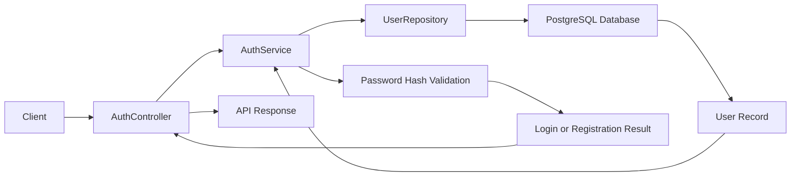
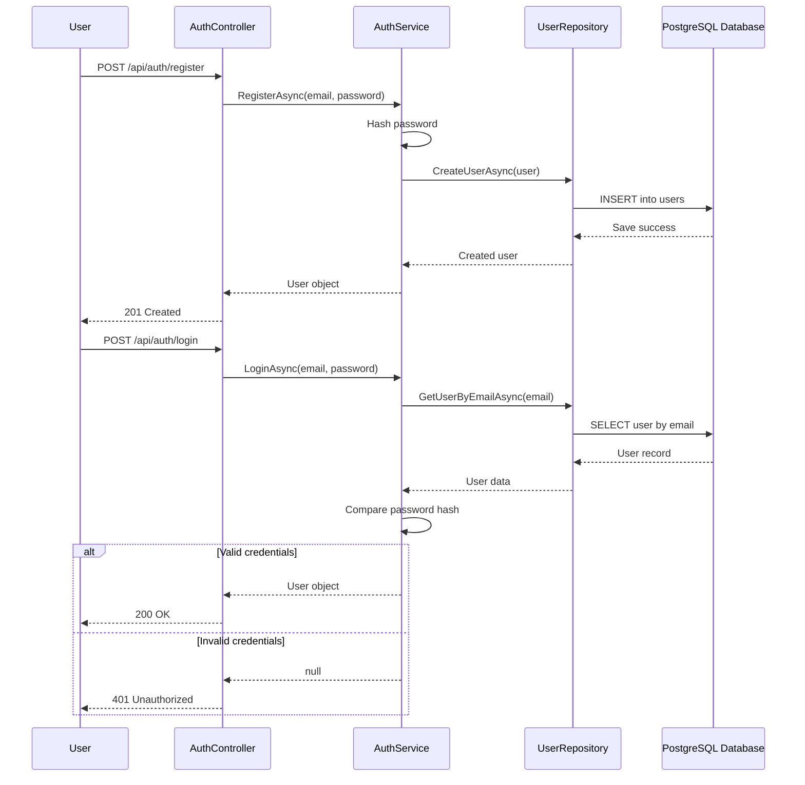

<!--
SEO Keywords:
.NET 8 Identity
ASP.NET Core Identity tutorial
registration login email confirmation .NET 8
Dapper PostgreSQL authentication
custom identity implementation .NET
secure login system .NET 8
ASP.NET Core authentication API
email confirmation in ASP.NET Core
C# identity example
.NET authentication with Dapper
-->

# Implementing .NET 8 Identity | Secure Registration, Login, and Email Confirmation

A practical ASP.NET Core Web API example for implementing user authentication and registration using .NET 8 patterns, PostgreSQL, and Dapper. This project demonstrates how to build a simple yet secure identity flow with user registration, login validation, and email confirmation logic.

## Overview

This repository showcases a clean, beginner-friendly implementation of authentication in .NET 8 using:

- ASP.NET Core Web API
- PostgreSQL database
- Dapper ORM
- Custom user repository pattern
- Password hashing with HMAC-SHA256
- Registration, login, and email confirmation workflow

The goal is to provide a solid example for developers who want to understand how identity logic works in .NET 8 without relying solely on full framework scaffolding.

## Why This Project Is Useful

If you are searching for:

- .NET 8 Identity
- ASP.NET Core Identity tutorial
- .NET 8 registration login email confirmation
- Dapper PostgreSQL authentication
- custom identity implementation .NET
- secure login system .NET 8
- ASP.NET Core authentication API
- email confirmation in ASP.NET Core
- C# identity example
- .NET authentication with Dapper

this project offers a practical reference implementation.

## Key Features

- User registration endpoint
- Login verification endpoint
- Secure password hashing
- PostgreSQL-backed user storage
- Dapper repository implementation
- Email confirmation flow placeholder and design pattern
- Clean API-oriented development workflow

## Architecture

The solution follows a simple layered design:

- Controller layer: exposes auth endpoints
- Service layer: business logic for registration and login
- Repository layer: database operations with Dapper
- Database layer: PostgreSQL table for users

## Data Flow Diagram



## Sequential Diagram



## Authentication Flow

1. A user submits registration data to the API.
2. The password is hashed before storage.
3. The user is inserted into the PostgreSQL database.
4. On login, the system reads the user by email.
5. The submitted password is hashed and compared with the stored hash.
6. A successful match returns the user data; otherwise a 401 response is returned.
7. Email confirmation logic is included as a confirmation step in the design flow.

## Benefits

- Stronger security: passwords are never stored in plain text.
- Clean separation of concerns: controller, service, and repository layers are separated.
- Easy to understand: a practical beginner-friendly identity flow.
- Database-driven design: user data lives in PostgreSQL for persistence.
- Extensible architecture: can be expanded for roles, JWT, email confirmation, and more.
- Good learning project for .NET developers working with authentication.

## Use Cases

- User registration systems for small business apps
- Internal admin portals and dashboards
- Secure login patterns for custom enterprise apps
- API-based authentication prototypes
- Learning and demonstration projects for .NET identity fundamentals
- Custom authentication systems without full ASP.NET Core Identity packages

## Technology Stack

- .NET 8
- ASP.NET Core Web API
- PostgreSQL
- Dapper
- C#
- REST API architecture

## Project Structure

```text
Implementing-.NET-8-Identity/
├── WebIdentityApp/
│   ├── Contacts/
│   ├── Controllers/
│   ├── Data/
│   ├── Models/
│   ├── Services/
│   ├── Program.cs
│   ├── appsettings.json
│   ├── appsettings.Development.json
│   ├── WebIdentityApp.csproj
│   └── WebIdentityApp.http
├── WebIdentityApp.sln
├── README.md
├── .gitignore
└── .gitattributes
```

## Setup Instructions

### Prerequisites

- .NET 8 SDK
- PostgreSQL database
- Visual Studio or VS Code

### Steps

1. Create the database and table structure for users.
2. Configure the PostgreSQL connection string in appsettings.json.
3. Restore NuGet packages.
4. Run the WebIdentityApp project.
5. Test registration and login via Swagger or a REST client.

## Security Notes

- Use secure password hashing strategies in production projects.
- Store sensitive settings like database credentials in environment variables or secure secrets.
- Use HTTPS and secure headers in production.
- Extend the project with JWT, role-based authorization, and proper email confirmation flows for production-grade authentication.

## SEO Recommendation for GitHub

To improve GitHub and search engine discoverability:

- add repository topics such as `dotnet`, `aspnetcore`, `identity`, `authentication`, `postgresql`, `dapper`, `csharp`
- keep the README structured and keyword-rich
- include screenshots or diagrams where possible
- publish linking references from your blog, portfolio, or social profiles
- maintain regular repository updates and documentation improvements

## Conclusion

This project demonstrates a practical and reusable custom authentication flow in .NET 8 using PostgreSQL and Dapper. It is especially useful for developers who want to understand the core mechanics behind registration, login, and email confirmation without the overhead of a fully scaffolded identity solution.

It provides a strong starting point for custom security patterns in real-world applications.

## License

This project is intended for educational and demonstration purposes.

---

Built for secure .NET authentication, custom identity implementation, and enterprise learning projects.
